<div align="center">
  
  <h1>Muruga.net — Property & Rental Management Platform</h1>
  <h3>Complete Product Showcase, Feature Guide & High-Converting Sales Pitch Deck</h3>
  <p><b>The All-in-One Local-First Rental ERP for PG, Hostels, Co-Living & House Rentals</b><br>
  <i>Zero Recurring Cloud Subscriptions • 100% Offline Capable • Strict Double-Entry Ledger • Private Remote Access</i></p>
</div>

---

## Executive Summary: Why Property Operators Choose Muruga.net

Operating modern rental properties—whether Paying Guest (PG) accommodations, student hostels, co-living spaces, or multi-unit apartment rentals—demands speed, absolute financial transparency, and operational control.

Most property managers are trapped between two frustrating extremes:
1. **Unreliable Spreadsheets & WhatsApp**: Rent slips through the cracks, UPI screenshots get lost in chat threads, tenant disputes arise over security deposits, and owners lack real-time visibility into actual profits.
2. **Expensive Cloud SaaS Portals**: Monthly recurring per-bed subscription fees (₹40 to ₹100 per bed every single month), slow page loads, internet downtime locking staff out of front-desk check-ins, and sensitive tenant identity records stored on third-party cloud servers.

**Muruga.net solves this forever.** It combines the blistering speed, privacy, and zero monthly fees of a **local-first desktop architecture** with the convenience of **military-grade remote access over private mesh VPN (Tailscale)**, automated **Google Forms paperless self-onboarding**, and a **tamper-evident double-entry financial engine**.

```
┌────────────────────────────────────────────────────────────────────────────────────────┐
│                                 THE VALUE TRIFECTA                                    │
├─────────────────────────┬──────────────────────────────┬───────────────────────────────┤
│   100% DATA OWNERSHIP   │     STRICT DOUBLE-ENTRY      │     PAPERLESS SELF-ONBOARD    │
│  Zero Per-Bed SaaS Fee  │  Airtight audit trails, no   │  QR & Google Forms sync with  │
│ Runs on your own PC/LAN │  ghost dues, deposit refund  │  automatic UTR matching and   │
│ with cloud drive backup │  safeguards & P&L passbooks  │  returning tenant detection   │
└─────────────────────────┴──────────────────────────────┴───────────────────────────────┘
```

---

## Comparison Matrix: Traditional vs Cloud SaaS vs Muruga.net

| Capability | Manual Excel / WhatsApp | Generic Cloud SaaS | **Muruga.net Platform** |
|---|---|---|---|
| **Monthly Subscription Cost** | Free (High manual labor) | ₹3,000 – ₹25,000 / month | **₹0 Recurring (One-Time / Owned)** |
| **Works Offline (Zero Internet)** | ✅ Yes (Manual) | ❌ Broken / Inaccessible | **⚡ 100% Full Functionality Offline** |
| **Remote Access Anywhere** | ❌ Manual file sharing | ✅ Web login | **🔒 Encrypted Private Mesh (Tailscale)** |
| **Financial Integrity** | ❌ Easy formula corruption | ⚠️ Single-entry ledger | **🛡️ Strict Double-Entry Engine** |
| **Security Deposit Safeguard** | ❌ Unregulated deductions | ⚠️ Casual edits allowed | **🔒 Immutable refund bills with lock** |
| **Tenant Self-Onboarding** | ❌ Paper forms & physical IDs | ⚠️ Proprietary app install | **📲 Instant Google Forms link + QR** |
| **Automated Due Reminders** | ❌ Manual copy-paste texts | ⚠️ Rate-limited SMS | **📧 Parallel SMTP Pool (Zoho/Gmail)** |
| **Multi-Tasking UI** | ❌ Single window | ❌ Heavy page reloads | **🪟 Universal Draggable Modals** |
| **Property Flexibility** | ❌ Clunky | ⚠️ Rigid room counts | **🏢 PG, Hostel & House Rental ready** |

---

# Detailed Tour of Core Completed Modules
*(Showcasing only active, fully completed modules in the system)*

---

### Module 1: Executive Dashboard & Portfolio Command Center
**Route:** `/`  
**Purpose:** Instant high-level oversight of cash collections, active occupancy rates, and room inventory across single or multi-property portfolios.

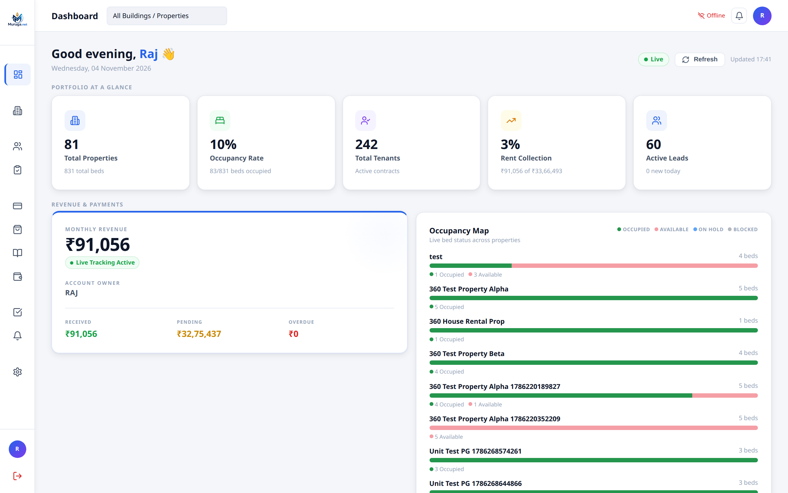

#### Key Capabilities & Sales Highlights:
* **Live KPI Glance Cards**:
  * **Total Properties & Total Beds**: Real-time count of all rooms and beds configured across your organization.
  * **Occupancy Rate Tracker**: Live visual percentage showing occupied vs available capacity.
  * **Total Active Tenants**: Active contracts count with instant drill-down.
  * **Monthly Rent Collection Progress**: Visual progress bar showing collected amount vs total receivables for the calendar month.
* **Consolidated Revenue & Cashflow Ledger**:
  * Displays Total Received, Pending Receivables, and Total Overdue with live color-coded warnings.
* **Property-Wise Live Occupancy Bars**:
  * Visual status bars showing green (Occupied), pink (Available), blue (On Hold), and red (Blocked) capacity per building.
* **Instant Building Switcher**: Filter the entire dashboard for a single property or view your entire real estate portfolio in one unified screen.

---

### Module 2: Properties & Rooms Architecture (PG, Hostel, House Rental)
**Routes:** `/properties`, `/properties/new`, `/properties/:id`  
**Purpose:** Complete structural visualization of flats, floors, rooms, and individual bed slots with real-time vacancy tracking and bulk setup tools.

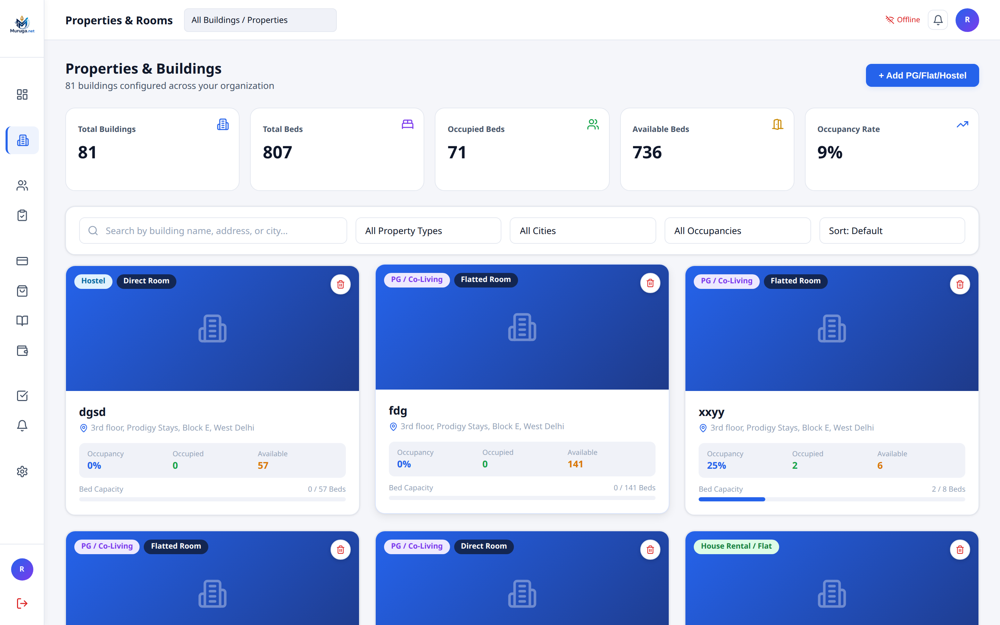

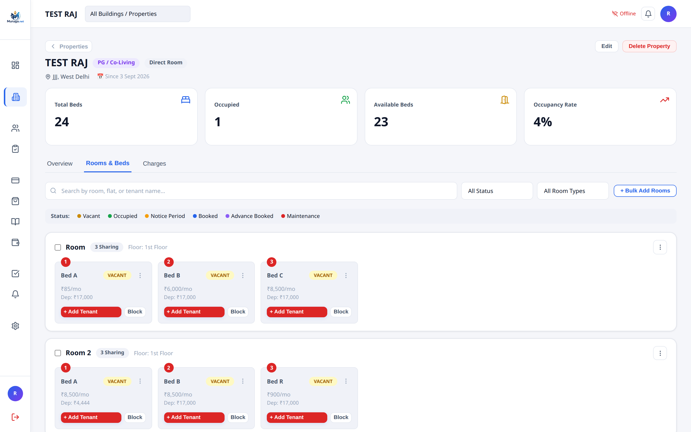

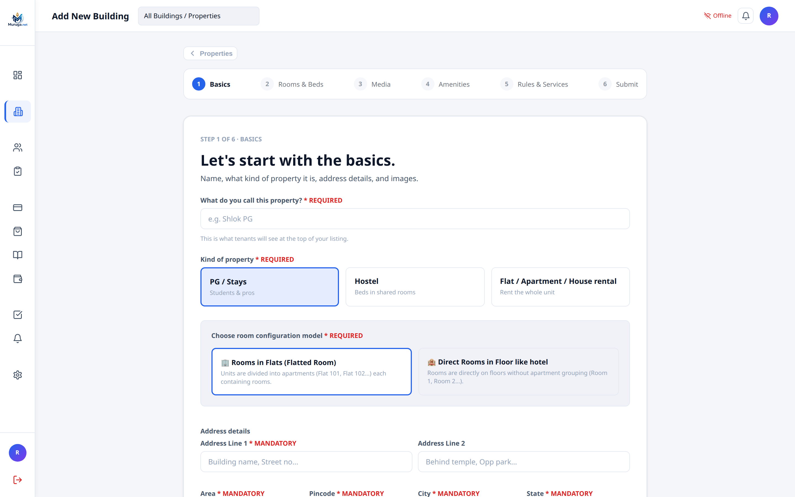

#### Key Capabilities & Sales Highlights:
* **Supports All 3 Major Rental Business Models**:
  1. **PG / Co-Living**: Hierarchical Flat $\rightarrow$ Room $\rightarrow$ Bed allocation with common living amenities.
  2. **Student Hostels**: Floor $\rightarrow$ Room $\rightarrow$ Bed structure with high-density bed management.
  3. **House & Apartment Rentals**: Whole flat/unit leasing with single-lease contracts (no bed splitting).
* **Interactive Room & Bed Cards with Real-Time Color Chips**:
  * 🟡 **VACANT**: Available for immediate booking with 1-click `+ Add Tenant` button.
  * 🟢 **OCCUPIED**: Live resident name, contact link, and stay details.
  * 🔵 **BOOKED / ADVANCE BOOKED**: Reserved units awaiting move-in date.
  * 🟠 **NOTICE PERIOD**: Highlights departing beds in advance to enable proactive pre-leasing.
  * 🔴 **MAINTENANCE / BLOCKED**: Withholds units undergoing repair from booking.
* **Custom Bed Sharing & Arbitrary Capacity ("Other" Option)**:
  * Beyond standard 1, 2, 3, 4, 5, or 6 sharing, choose **"Other"** to configure custom bed counts ($N \ge 1$ up to 100 beds per hall/dormitory) with dynamic bed labeling (`Bed A` ... `Bed Z`, `Bed 27`+).
* **Unit Remarks with 1-Click Clear**:
  * Add canonical operational notes to specific beds (e.g., "AC remote replaced", "Corner window bed", "Mattress upgrade requested") with instant badge display and quick trash icon cleanup.
* **Bulk Room Operations**:
  * Apply property-wide rent revisions, discount caps, or amenity updates across dozens of rooms in seconds.
* **5-Step Onboarding Wizard**:
  * Onboard brand-new buildings in under 3 minutes with step-by-step structural configuration, photo uploads, amenities checklist, and house rules.

---

### Module 3: 360° Tenant Directory & Comprehensive Dossier
**Routes:** `/tenants`, `/tenants/add`, `/tenants/:id`  
**Purpose:** End-to-end resident lifecycle management from check-in to room shifting, payment ledger, notice period tracking, and final move-out settlement.

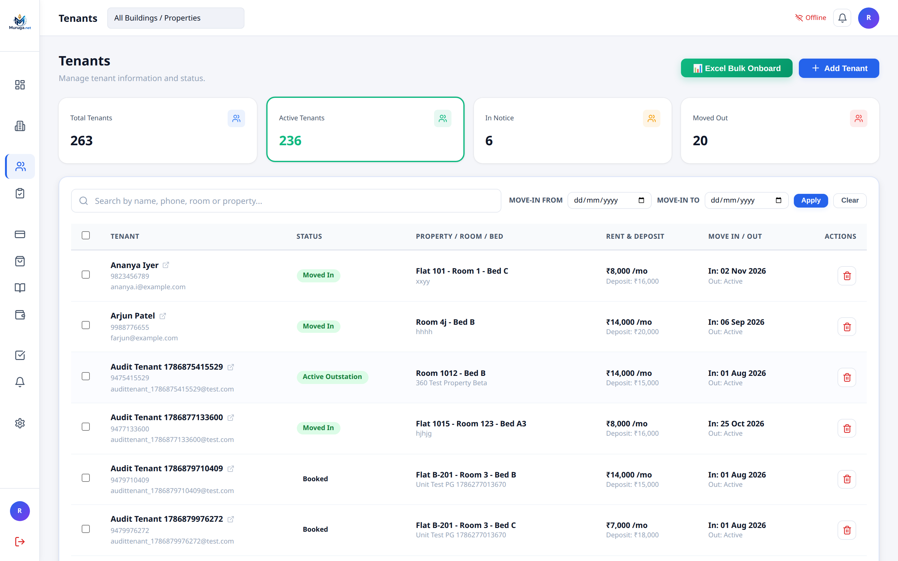

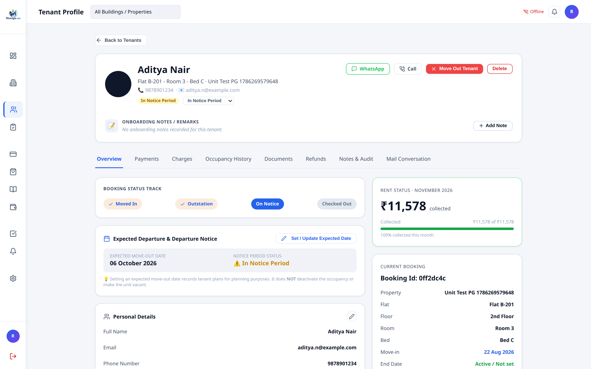

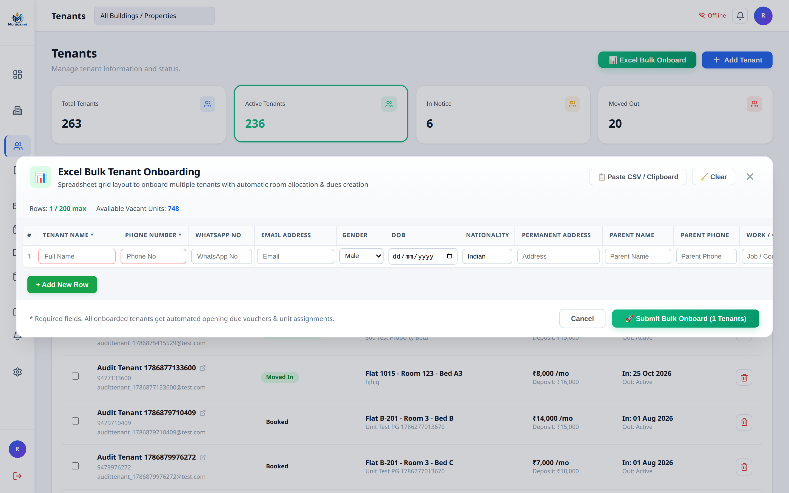

#### Key Capabilities & Sales Highlights:
* **Interactive Tenant Directory**:
  * Clean, responsive table featuring resident name, phone number, email, assigned Flat/Room/Bed, monthly rent, deposit held, move-in date, and active status chips (`Moved In`, `Active Outstation`, `Booked`, `In Notice`).
  * Full row-click navigation opens the resident dossier immediately.
* **Excel-Style Bulk Onboarding Modal**:
  * Mass-onboard up to 200 tenants simultaneously via an intuitive spreadsheet grid with CSV copy-paste support, auto-rent computation, and automated opening due generation.
* **360° Resident Profile & Dossier**:
  * **Instant Communication Actions**: Direct **WhatsApp** and **Click-to-Call** buttons in the header for 1-click contact.
  * **Automated Age Calculation**: Smart `🎂 X yrs` calculation badge from date of birth across all standard date formats.
  * **Departure Notice Tracking**: Explicitly track expected departure dates, notice status, and outstation leaves.
  * **Room Shifting Engine**: Shift tenants between beds, rooms, or flats with automated rent adjustments and vacancy updates in a single click.
  * **Onboarding Notes & Remarks**: Store notes with quick suggestion preset chips (`Student`, `Working Professional`, `Vegetarian`, `Night Shift`).
  * **Full Sub-Tabs Suite**: Dedicated tabs for Overview, Billing & Payments, Recurring Charges, Occupancy History, KYC Documents (Aadhaar front/back), Security Deposit Refunds, and Email Conversation History.

---

### Module 4: Paperless Tenant Self-Onboarding & Google Forms Sync
**Route:** `/tenant-applications`  
**Purpose:** Eliminate physical paper forms and manual data entry by empowering prospective residents to register from their own smartphones.

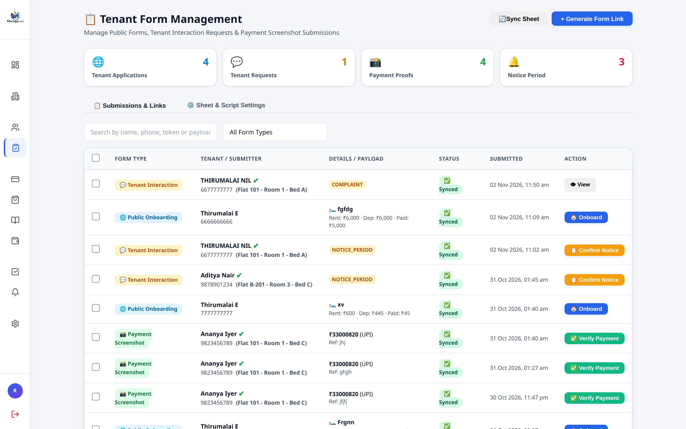

#### Key Capabilities & Sales Highlights:
* **Google Forms & Google Sheets Bi-Directional Auto-Sync**:
  * Connects directly with Google Apps Script to synchronize applicant responses straight into your local database.
* **Fresh & Pre-Filled Link Generator with QR Codes**:
  * Generate a general QR code for reception desks or pre-filled personalized links locking in specific rooms and rental terms.
* **Smart UTR & Payment Reference Detection**:
  * Automatically scans form payloads to extract UPI transaction references and UTR numbers, reducing payment verification time to seconds.
* **Returning Tenant Intelligence**:
  * Automatically checks incoming applications against past tenant records. If a former resident who officially moved out returns, the system links their stay history while creating a fresh occupancy without data duplication.
* **1-Click Full Onboarding**:
  * Review form data, verify ID documents, and click **Onboard** to instantly assign the room, create opening dues, issue the security deposit receipt, and trigger the welcome email!

---

### Module 5: Rent Billing, Payments-In & Receipt Generation
**Route:** `/payments`  
**Purpose:** Automated monthly rental billing, fee tracking, collection recording, and instant digital receipt creation.

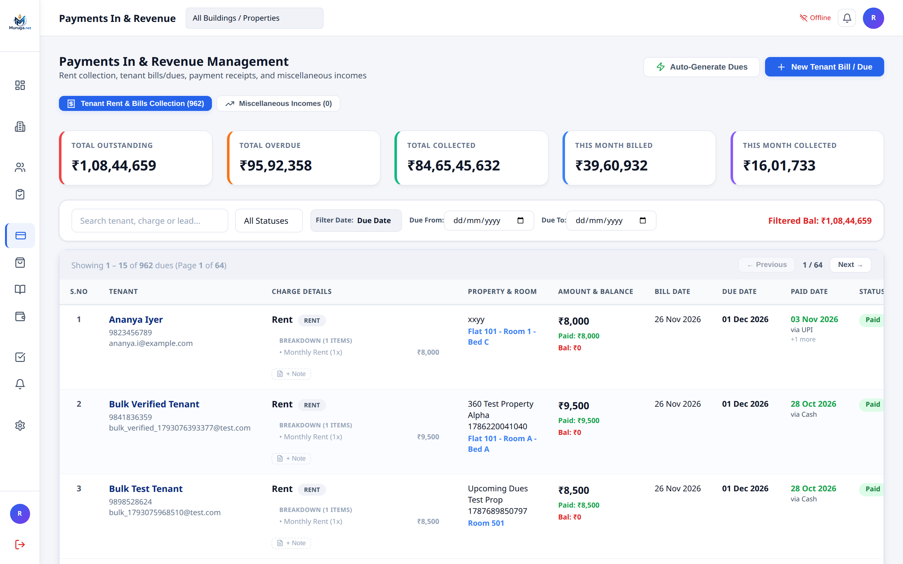

#### Key Capabilities & Sales Highlights:
* **Comprehensive Financial Metrics**:
  * Top KPI cards displaying **Total Outstanding**, **Total Overdue**, **Total Collected**, **This Month Billed**, and **This Month Collected**.
* **Detailed Dues & Invoicing Register**:
  * Clear column separation for **Bill Date**, **Due Date**, and **Paid Date** (featuring payment channel tags like `via UPI`, `via Cash`, `via Bank Transfer`).
  * Overdue indicators highlight unpaid accounts instantly.
* **Contextual Due Notes & Remarks**:
  * Attach notes directly to individual bills with quick suggestion presets (`+ Paid via UPI`, `+ Paid in full`, `+ Advance adjusted`, `+ Cheque received`, `+ Cash at counter`).
  * Notes synchronize seamlessly between the payment collection dialog and the tenant profile.
* **Automated Due Generation Engine**:
  * 1-click recurring monthly rent generation based on tenant contract dates and customized charge templates.
* **Instant Digital Payment Receipts**:
  * Generate professional, printable, and downloadable payment receipts featuring property branding, GST details, tenant name, room allocation, and transaction mode.

---

### Module 6: Purchases, Expenses & Payout Disbursements
**Route:** `/purchases`  
**Purpose:** Centralized payables management for vendor procurement, facility maintenance bills, owner operational expenses, and refund vouchers.

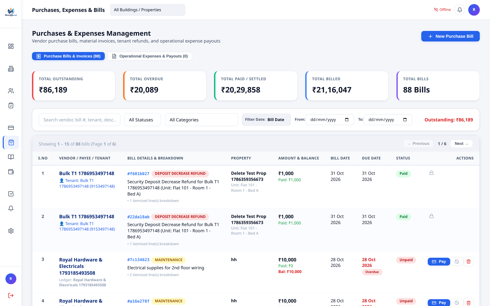

#### Key Capabilities & Sales Highlights:
* **Payables Dashboard**:
  * Track Total Outstanding Payables, Overdue Vendor Bills, Total Paid/Settled, and Gross Incurred Costs.
* **Vendor Procurement & Maintenance Invoices**:
  * Record bills for plumbing, electrical supplies, WiFi broadband, housekeeping consumables, food groceries, and utilities.
  * Direct 1-click **Pay** button to disburse partial or full payments.
* **Serialized Payment Vouchers (`PV-YYYY-####`)**:
  * Automatically issues unique, sequential payment vouchers for every money-out transaction for complete auditor compliance.
* **Immutable Deposit Decrease Refund Safeguards**:
  * Decreasing a tenant's security deposit automatically generates an immutable `DEPOSIT_DECREASE_REFUND` purchase bill paired with a mandatory `PaymentOut` voucher.
  * These records are locked against deletion or cancellation, permanently safeguarding property owners against staff embezzlement.

---

### Module 7: Account Ledgers & Party Directory (Passbook Statement)
**Routes:** `/ledgers`, `/ledgers/:id`  
**Purpose:** Complete party accounting for vendors, contractors, and corporate payers with automated double-entry chronological running balance statements.

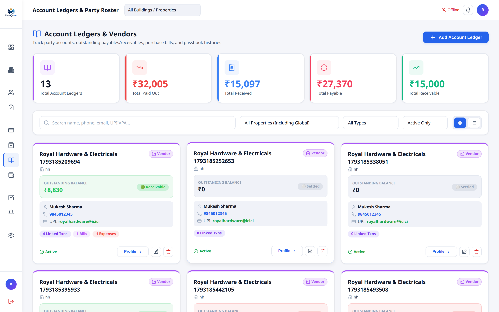

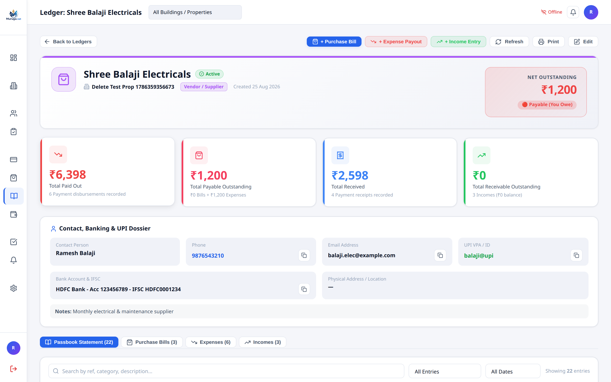

#### Key Capabilities & Sales Highlights:
* **Party Directory with Live Balance Chips**:
  * Directory cards for all external parties with phone numbers, contact persons, and UPI VPAs.
  * Color-coded status chips indicate whether you owe money (🔴 **Payable**), are owed money (🟢 **Receivable**), or the account is balanced (⚪ **Settled**).
* **Global or Property-Scoped Accounts**:
  * Support for business-wide shared suppliers (e.g. wholesale grocery suppliers) or single-building contractors.
* **Dedicated Party Profile & Complete Banking Dossier**:
  * 1-click clipboard copy for vendor Bank Account numbers, IFSC codes, and UPI IDs.
* **Double-Entry Chronological Passbook**:
  * Automatically calculates Debit (Dr), Credit (Cr), and running balance across all linked Purchase Bills, Expense Payouts, Payment Vouchers, and Incomes.
  * Export passbooks or print statements directly for vendor reconciliation.

---

### Module 8: Owner Accounting Ledger & True Safe Cashflow
**Route:** `/accounts`  
**Purpose:** High-level executive accounting, capital investment tracking, owner withdrawals, and calculation of true distributable cash flow.

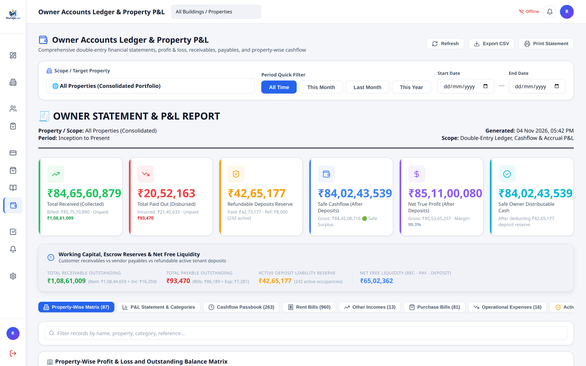

#### Key Capabilities & Sales Highlights:
* **Comprehensive Owner P&L Statement**:
  * Calculates Gross Revenues Collected vs Total Operational Disbursements.
* **Refundable Deposit Liability & Escrow Reserve**:
  * The software automatically tracks the total pool of active tenant security deposits held.
* **"Safe Distributable Cash" Metric**:
  * Crucial safeguard for property owners: calculates actual free cashflow *after* subtracting active refundable deposit liabilities. Owners never risk accidentally spending security deposits as operational profit!
* **Net Free Working Capital Liquidity**:
  * Compares receivables outstanding vs payables outstanding vs active deposit liabilities in real time.
* **Multi-Tab Financial Views**:
  * Instant access to Property-Wise Matrix, P&L Statement by category, and full Cashflow Passbook.

---

### Module 9: Operations & Maintenance Task Board
**Route:** `/tasks`  
**Purpose:** Visual operational workflow for property repairs, tenant complaint resolution, cleaning checklists, and regulatory inspections.

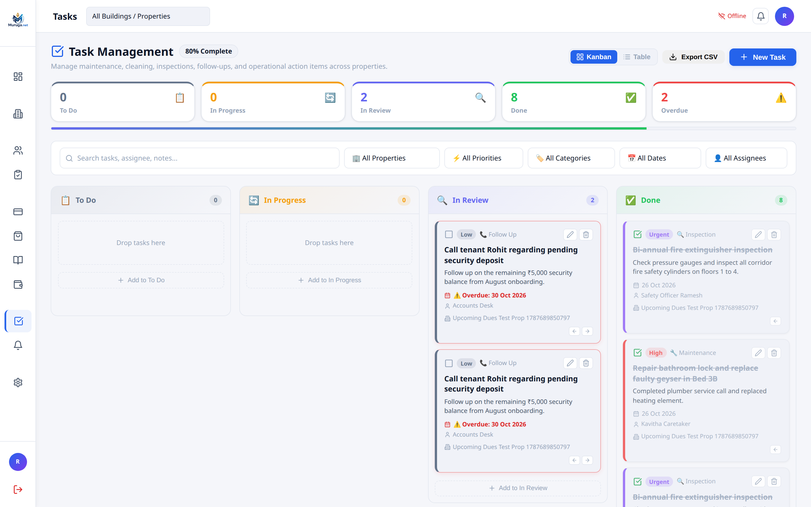

#### Key Capabilities & Sales Highlights:
* **Interactive Drag-and-Drop Kanban Board**:
  * Organize tasks into clear stages: **To Do**, **In Progress**, **In Review**, and **Done**.
* **Category & Priority Chips**:
  * Tag tasks by category (`Maintenance`, `Inspection`, `Cleaning`, `Follow Up`) and urgency (`Urgent`, `High`, `Medium`, `Low`).
* **Staff Assignment & Overdue Tracking**:
  * Assign tasks to specific property caretakers, safety officers, or desk staff with clear target deadlines and overdue warning alerts.
* **Progress Percentage Indicator**:
  * Real-time completion progress bar across all scheduled property tasks.

---

### Module 10: Announcements & Notice Broadcast Board
**Route:** `/notices`  
**Purpose:** Send broadcast updates, emergency alerts, maintenance schedules, and holiday announcements to all residents or selected buildings.

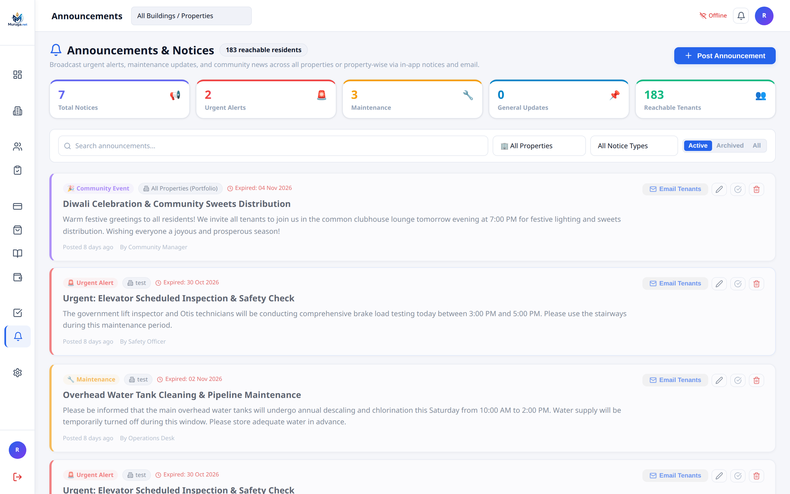

#### Key Capabilities & Sales Highlights:
* **Targeted Notice Distribution**:
  * Broadcast announcements across the entire organization or isolate notices to a single building.
* **Notice Categorization**:
  * Pre-styled templates for `Community Event`, `Urgent Alert`, `Maintenance`, and `General Updates`.
* **Reachability Counter**:
  * Real-time metric showing the exact number of active reachable tenants currently in residence.
* **1-Click Tenant Email Dispatch**:
  * Push notices directly to residents' inboxes via the integrated SMTP email engine.
* **Notice Expiry Scheduling**:
  * Automatically archives time-sensitive alerts once the expiry date passes.

---

### Module 11: Settings, Business Profile & Multi-Account SMTP Engine
**Route:** `/settings`  
**Purpose:** Business identity, GST invoicing, UPI payment configurations, multi-account email pool management, and automated reminder schedules.

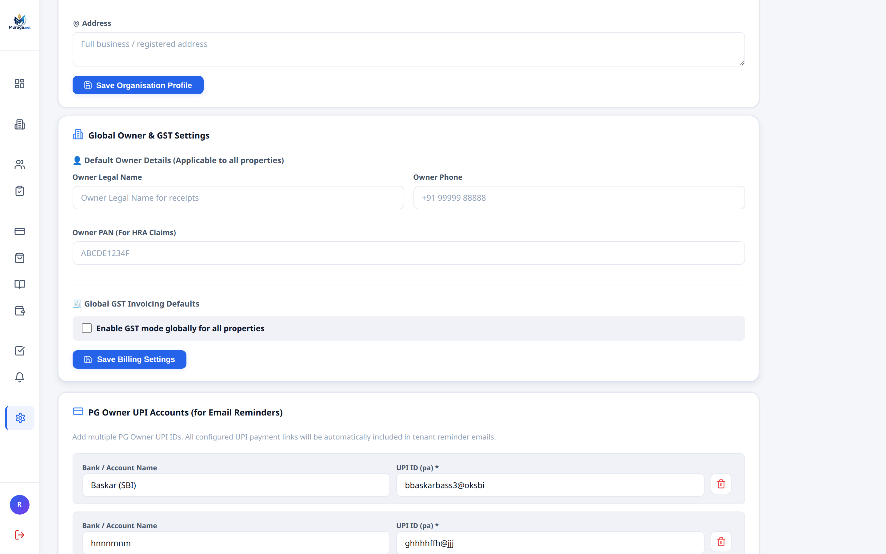

#### Key Capabilities & Sales Highlights:
* **Business Branding & GST Profile**:
  * Configure organization name, address, business PAN, and GSTIN defaults for all generated invoices and receipts.
* **PG Owner Multiple UPI Accounts**:
  * Add multiple owner UPI VPAs with custom bank labels; dynamic UPI payment links and QR codes are automatically embedded in tenant reminder emails.
* **High-Throughput Multi-Account SMTP Email Pool**:
  * Distribute outgoing email volume across multiple accounts (Zoho Mail, Gmail, Microsoft 365, Transactional) with independent daily volume caps and circuit breakers.
* **Provider-Aware Auto-Tuning Engine**:
  * Automatically detects SMTP providers and tunes connection sockets, batch sizes, and pacing delays (Zoho: 4.0s, Gmail: 3.0s, M365: 2.5s, Transactional: 0.2s) to prevent spam flags or provider blocks.
* **Parallel Automated Due Reminder Engine**:
  * Automated cron engine processes reminder queues in parallel.
  * Consolidates multiple overdue bills for the same resident into a single, clean notification email.
  * Graduated schedule: Pre-due reminders (days 7, 5, 3, 2, 1), due date notification, and daily overdue follow-ups.

---

## Technical & Architectural Superiority

### 1. Universal Draggable & Transparent Modal Windows
Unlike conventional web software where opening a dialog hides your background data, Muruga.net features the **`DraggableModalManager`**:
* **100% Zero Backdrop Blur**: Backdrops enforce zero blur so background tables, occupancy numbers, and tenant names remain razor-sharp.
* **Ultra-Clear Drag State**: While dragging a modal aside, backdrop opacity drops to 5%, allowing seamless comparison of background data while filling forms.
* **Double-Click Reset**: Double-click any modal header to smoothly re-center it.

### 2. Private Remote Access over Tailscale Mesh VPN
* Property owners can securely access their complete management portal from iPhones, Android devices, iPads, or laptops anywhere in the world.
* Operates over private WireGuard-encrypted mesh VPN (`http://100.x.y.z:3000`) with **zero port-forwarding**, **zero static IP cost**, and **zero vulnerability to public internet port scanners**.

### 3. Native Standalone Installers (.exe)
* Standalone Windows Installer (`Muruga-Software-Setup-v1.0.0.exe`) bundles portable Node.js, silent background VBS launcher, SQLite database engine, and automatic database migration on startup.
* No complex terminal commands required for the client—simply double-click to install and run!

---

## Commercial ROI & Value Proposition for Customers

```
┌────────────────────────────────────────────────────────────────────────────────────────┐
│                          RETURN ON INVESTMENT (100-BED PG)                             │
├─────────────────────────────────────────────────┬──────────────────────────────────────┤
│ Cost of Traditional Cloud SaaS (₹60/bed/month)  │ ₹72,000 / year (Year after year)     │
│ Cost of Missed / Forgotten Tenant Dues (Avg 3%) │ ₹36,000 / year (Unrecovered loss)    │
│ Manual Staff Time on Receipts & WhatsApp        │ 15 hours / week (~₹90,000 in wages)  │
├─────────────────────────────────────────────────┼──────────────────────────────────────┤
│ TOTAL TRADITIONAL EXPENSE & LOSS                │ ₹1,98,000+ per year                  │
├─────────────────────────────────────────────────┼──────────────────────────────────────┤
│ WITH MURUGA.NET PLATFORM                        │ ONE-TIME SETUP • ZERO PER-BED FEES   │
│ ESTIMATED ANNUAL SAVINGS                        │ ₹1,50,000+ EVERY YEAR                │
└─────────────────────────────────────────────────┴──────────────────────────────────────┘
```

---

## Recommended Sales Next Steps
1. **Live Interactive Walkthrough**: Schedule a 15-minute screen-share showcasing the **Visual Room Grid** and **Google Forms Self-Onboarding**.
2. **Custom Building Demonstration**: Set up the customer's actual floor plan (e.g. 3 floors, 12 rooms) in the 5-step wizard to show immediate familiarity.
3. **Instant Pilot Deployment**: Install the standalone Windows installer on the customer's reception PC or server with zero downtime.

